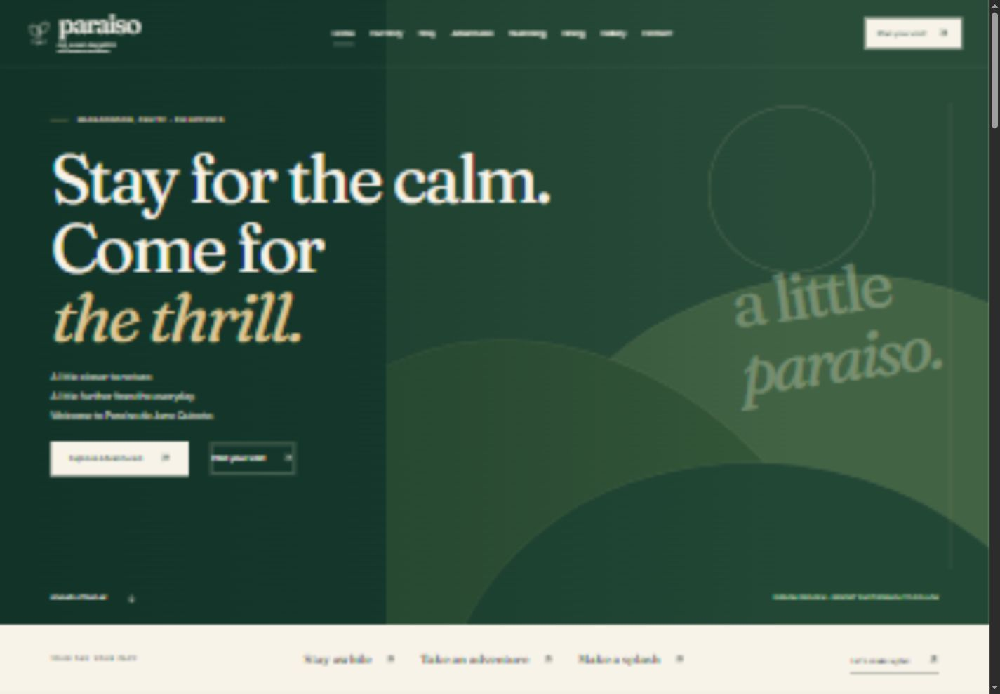
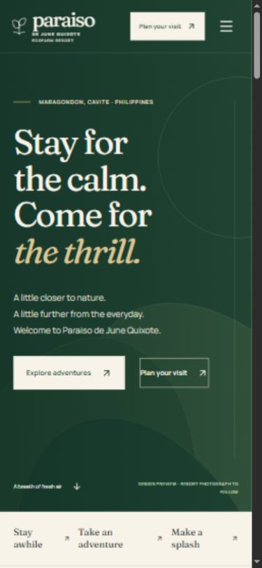

# Verification results

Executed 16 November 2026 using Node.js 24.18.1 and npm 11.16.0 on Windows.

## Automated checks

| Check | Actual result |
| --- | --- |
| `npm run typecheck` | Passed, exit 0. |
| `npm run lint` | Passed, exit 0 after fixing the gallery body-style mutation and test helper naming. |
| `npm run build` | Passed; Next.js 16.4.6 generated a static `out/` export. All public routes reported as static. |
| `npm test` | Six tests passed; zero failures, skipped tests, or cancellations. |
| `npm prune --no-audit --no-fund` | Removed one extraneous package from the interrupted earlier installation. |

The six export audits cover all required page documents, one H1/main landmark, page titles, review indexing configuration, every rendered internal link and fragment, linked script/media assets, backend/dependency removal, the real booking configuration's fallback/HTTPS behavior, rendered CTA destinations, local fonts, static image handling, robots output, and the 404 file. Tests adapt to a later approved domain/indexing or external booking configuration.

The production build completed without a database URL, authentication secret, email account, media service, environment file, or backend process. `out/` is the full deployable site.

## HTTP checks against the exported files

Started only the local static preview utility and requested every required page. All ten returned HTTP 200. `/not-a-real-page/`, `/admin/`, and `/api/reservations/` returned HTTP 404. No booking/admin/API application is present.

## Browser checks against the static export

- Visited all ten pages at a 1440px desktop viewport: no horizontal overflow; no broken loaded images.
- Inspected phone layouts at 390px, and all ten routes at 320px: no horizontal overflow. Explicitly checked 390px homepage/about, accommodation, adventure, pool, dining, gallery, packages, contact, and FAQ layouts.
- Visited all ten pages at 768px tablet width: no horizontal overflow.
- Opened the mobile navigation dialog; verified navigation to the gallery. Escape closed the menu, released the body scroll lock, and returned focus to the menu button.
- Selected FAQ Reservations filter; only the matching questions remained. Expanded the booking/payment question and verified the informational answer became visible.
- Selected the gallery Swimming filter; exactly one matching layout placeholder remained. Placeholder panels are not interactive and do not open an empty lightbox.
- Used the homepage's scroll link; verified the story anchor landed below the fixed header and the header changed to a solid background.
- Browser warning/error log query returned no entries during the route checks.
- Saved desktop and mobile homepage screenshots in `docs/screenshots/`.

A browser navigation timed out during the first mobile batch. Recovered the existing tab and repeated checks with explicit viewport settings; no application fault was observed. One unsupported browser performance inspection was dropped; no network-performance or Lighthouse claim is made.

## Verification limits

- No approved resort photos were provided. The actual-image lightbox, next/previous navigation, and real photo loading/cropping need another visual check once approved media is added. The implemented placeholders and filters were tested.
- No Lighthouse score, automated WCAG certification, screen-reader session, Safari/iOS device test, or Android hardware test was run. Responsive browser tests are not a substitute for real-device review.
- The official Facebook destination was verified in link configuration and exported markup; no message was sent and current resort operations were not verified through a login.
- Search indexing remains disabled pending approved content and a verified domain. Sitemap entries and canonical links are intentionally omitted until the domain is set.
- No deployment was performed. Hosting-provider security headers, domain DNS, and the partner's future reservation application require their own deployment checks.

## Visual review captures

